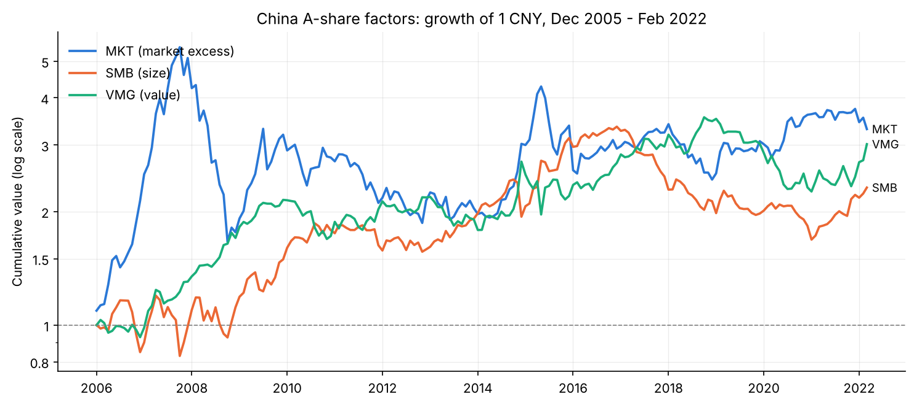
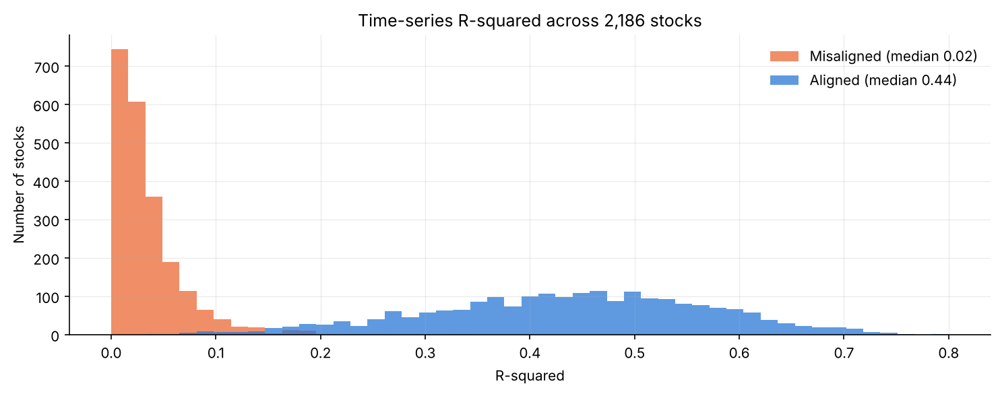

# China A-Share Fama-French Three-Factor Model

A from-scratch build of the Fama-French (1993) three-factor model for China A-shares. It uses monthly data from
December 2005 to February 2022, an average of 1,422 stocks a month after filters, and per-stock time-series
regressions for the 2,186 stocks with at least 36 months of history.

The notebook also documents a timing bug I made and then fixed. The first version paired factor returns from
month *t* with stock returns from month *t+1*, which pushed the median R² down to 0.02. After aligning the two, the
median R² is 0.44.



## Results

Factor premia, 195 months (monthly mean, HAC t-statistics with 3 lags):

| Factor | Monthly mean | Annualized | t-stat |
|---|---:|---:|---:|
| MKT (market minus risk-free) | 0.92% | 11.1% | 1.42 |
| SMB (small minus big) | 0.57% | 6.9% | 1.44 |
| VMG (value minus growth) | 0.68% | 8.1% | **2.07** |

- Only the **value premium** is significant at the 5% level. The size premium is positive but not significant over
  this sample.
- Across all 2,186 per-stock regressions, the **median R² rises from 0.02 to 0.44** once factor and stock returns
  cover the same month.



## Method

1. **Universe filters** (applied every month):
   - drop the bottom 30% by market cap (shell-company risk)
   - drop suspended stocks (zero volume) and stocks with PB ≤ 0
   - drop IPOs listed less than 6 months
2. **2 × 3 sorts:**
   - size is split at the monthly median (Small / Big)
   - book-to-market (1/PB) is split at the 30th and 70th percentiles (Growth / Neutral / Value)
   - the six portfolios are value-weighted
3. **Factors:**
   - SMB = average(SV, SM, SG) − average(BV, BM, BG)
   - VMG = average(SV, BV) − average(SG, BG)
   - MKT = value-weighted market return − Rf
4. **Risk-free rate:** the PBoC one-year deposit benchmark rate, matched to each month with an as-of merge and divided
   by 12.
5. **Regressions:** each stock's excess return is regressed on MKT, SMB and VMG with OLS (HAC errors for the example
   stock).

### The alignment fix

| | Portfolio formed on | Factor return measured over | Stock return explained |
|---|---|---|---|
| First pass (Sections 4–6) | month-*t* characteristics | month *t* | month *t+1* |
| Corrected (Section 7) | month-*t* characteristics | month *t+1* | month *t+1* |

The first pass is kept in the notebook on purpose, so the before/after comparison can be reproduced.

## Repository layout

```
fama_french_3factor.ipynb   end-to-end notebook (executed, with outputs)
data/README.md              data schema and sources
data/Rf_data.xlsx           one-year deposit rate history
figures/                    charts used in this README
requirements.txt
```

## Reproduce

```bash
pip install -r requirements.txt
# put Monthly_PB_PS_PE_MV_R_TR.xlsx in data/ (see data/README.md)
jupyter nbconvert --to notebook --execute --inplace fama_french_3factor.ipynb
```

A full run takes about 3 minutes, most of it spent on the 2,186 per-stock regressions.
